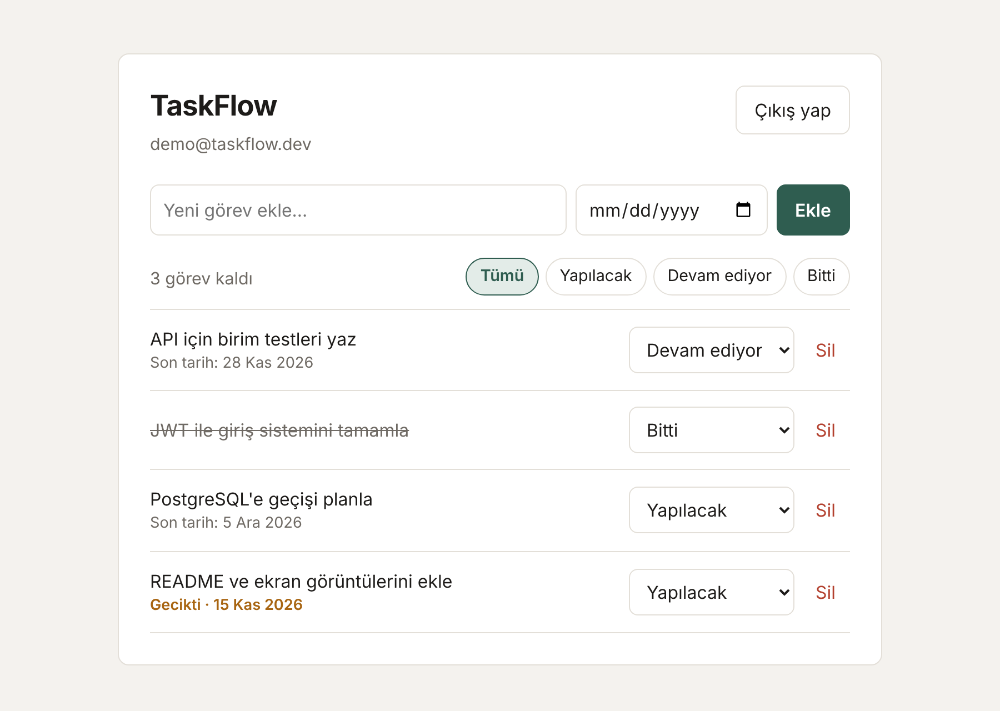

# TaskFlow

A full-stack task manager with user accounts. A React front end talks to an ASP.NET Core Web API secured with JWT, and each user can only see and change their own tasks. Data is stored in SQLite through Entity Framework Core.

I built this project to learn how the pieces of a web application fit together end to end: HTTP and REST, a layered backend, authentication, database relationships and a component-based UI.



## Features

- Register and log in; passwords are stored as salted hashes, never in plain text
- JWT authentication: every task request carries a signed token
- Per-user data: tasks are always queried by owner, and another user's task returns 404
- Create tasks with an optional due date, change their status, filter and delete them
- Validation on the server with clear messages shown under the form fields
- Overdue tasks are highlighted; responsive layout with a dark theme

## Tech stack

| Layer | Technology |
| --- | --- |
| Frontend | React, Vite |
| Backend | ASP.NET Core Web API (.NET 10), C# |
| Database | SQLite, Entity Framework Core (code-first migrations) |
| Auth | JWT bearer tokens, ASP.NET Core `PasswordHasher` |

## How it is put together

```
React (localhost:5173)  --HTTP + JSON, Authorization: Bearer <token>-->  ASP.NET Core API (localhost:5000)  --EF Core-->  SQLite
```

- **Controllers** (`AuthController`, `TasksController`) expose the REST endpoints.
- **DTOs** (`SaveTaskDto`, `AuthDto`) define what the API accepts and hold the validation rules, so the client can never set fields like `Id` or `UserId`.
- **Entities** (`TaskItem`, `User`) map to tables; `AppDbContext` defines the one-to-many relationship, a unique email index and cascade delete.
- **Program.cs** registers services through dependency injection and sets up the middleware pipeline: CORS, authentication, authorization, routing.
- On the frontend, `api.js` is the single place that talks to the server: it attaches the token, turns error responses into readable messages and logs the user out on a 401.

## API

| Method | Endpoint | Description |
| --- | --- | --- |
| POST | `/api/auth/register` | Create an account (201, or 409 if the email exists) |
| POST | `/api/auth/login` | Returns a JWT (200, or 401) |
| GET | `/api/tasks` | List the current user's tasks |
| GET | `/api/tasks/{id}` | Get one task |
| POST | `/api/tasks` | Create a task (201, or 400 on invalid data) |
| PUT | `/api/tasks/{id}` | Update a task (204) |
| DELETE | `/api/tasks/{id}` | Delete a task (204) |

All `/api/tasks` endpoints require a valid token.

## Running locally

Requirements: .NET 10 SDK, Node.js, and the EF Core CLI (`dotnet tool install --global dotnet-ef`).

**Backend**

```bash
cd TaskFlow.Api
dotnet ef database update   # creates taskflow.db from the migrations
dotnet run                  # http://localhost:5000
```

**Frontend** (in a second terminal)

```bash
cd taskflow-web
npm install
npm run dev                 # http://localhost:5173
```

Open http://localhost:5173 and create an account.

> The JWT signing key in `appsettings.Development.json` is a placeholder for local development only. In a real deployment it would come from an environment variable or a secret store.

## What I would improve next

- Unit and integration tests, especially for the per-user access rules
- Store the token in an HttpOnly cookie instead of `localStorage`, and add refresh tokens
- Use an enum for task status instead of strings
- Rate limiting on the login endpoint, and pagination for long task lists
- Move to PostgreSQL and deploy the app
